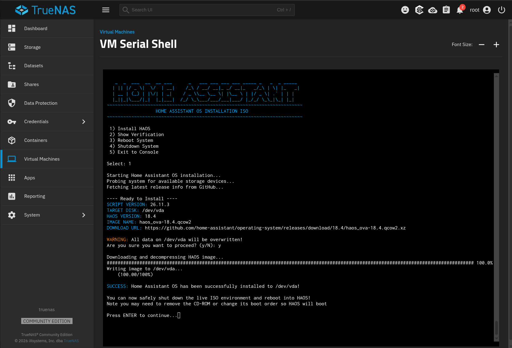

# truenas-haos-installer

### An Installation ISO for Home Assistant OS (HAOS)

While I find the standard method of installing HAOS rather trivial, I understand that some users would prefer a more traditional approach. With that in mind, I put together an ISO you can use as installation media when creating your HAOS VM in TrueNAS.

ISOs are available for download on the [Releases](https://github.com/tprelog/truenas-haos-installer/releases) page.

Booting the ISO automatically launches a simple, [menu-driven script](https://github.com/tprelog/truenas-haos-installer/blob/main/airootfs/usr/local/bin/install-haos) in the VM's Serial Shell, which is accessible directly from the TrueNAS UI. No SPICE or VNC clients required.



When you start an installation, the script probes the VM to find its drive path and queries the GitHub API to fetch the latest HAOS release data. Then, it uses that information to (1) download, (2) extract, and (3) write the [HAOS image for KVM](https://www.home-assistant.io/installation/linux/#install-home-assistant-operating-system) to the disk. To be clear, this will always install the current stable HAOS release. You don’t need to update the install script or ISO with each new HAOS release.

I recorded a video while testing release `v26.11.3-mini` (ISO 26.11.12-mini) on TrueNAS 27-RC1. I’m sorry, there is no sound, but it does show a real-time, uncut run-through of the installation from creating the VM to opening the Home Assistant landing page for the first time. I suggest setting YouTube's playback speed to 2-3x to watch the full video without wasting much time.

https://youtu.be/PoigcWGgvVE

## Additional Information

I'm still skeptical about this project's utility, so I haven't spent much time on it. At this point, the ISO and installation script are only tested for use in TrueNAS VMs; however, they may work in other KVM-based systems that support the `haos_ova.qcow2` image. Additionally, the script expects a single drive to be present and will trigger an error and exit if multiple drives are detected.

If there is any interest in further development, the ability to specify a specific version of HAOS, or even changing this Arch-based ISO to something more appropriate may be considered in the future.

So, why choose Arch Linux for this project in the first place? Well, Arch has been my daily driver for several years, and for now, I'd consider this installation ISO a *proof-of-concept*. I didn't want to spend a bunch of time on something that may very well be useless. Since I'm already using Arch, building the custom ISO was simple.

These are the basic commands to prepare an Arch system and build the ISO:

```bash
# 1. Install the archiso tool package
sudo pacman -S archiso

# 2. Copy the default releng profile files to your build directory
cp -r /usr/share/archiso/configs/releng/* .

# 3. Create a temporary working directory and compile the ISO
mkdir -p /tmp/archiso-work
mkarchiso -v -w /tmp/archiso-work -o ./iso .
```

#### ISO Modifications
To create the initial ISO, I made these minimal modifications to the default releng profile:

* **Add Installation Script:** Added the [`install-haos`](https://github.com/tprelog/truenas-haos-installer/blob/main/airootfs/usr/local/bin/install-haos) script to `airootfs/usr/local/bin/`
* **Add Script Dependencies:** Added `jq` and `qemu-img` to [`packages.x86_64`](https://github.com/tprelog/truenas-haos-installer/commit/e35682a95d63851dcd2c21a5e1267df66c201607)
* **Configure Default Profile:** Added hooks for `install-haos` and set ISO info in [`profiledef.sh`](https://github.com/tprelog/truenas-haos-installer/commit/dabbfbd2c060e0d16bf6827bf440833ac16c3fdd)

## License
Apache License 2.0 - The full text is in the LICENSE file.
