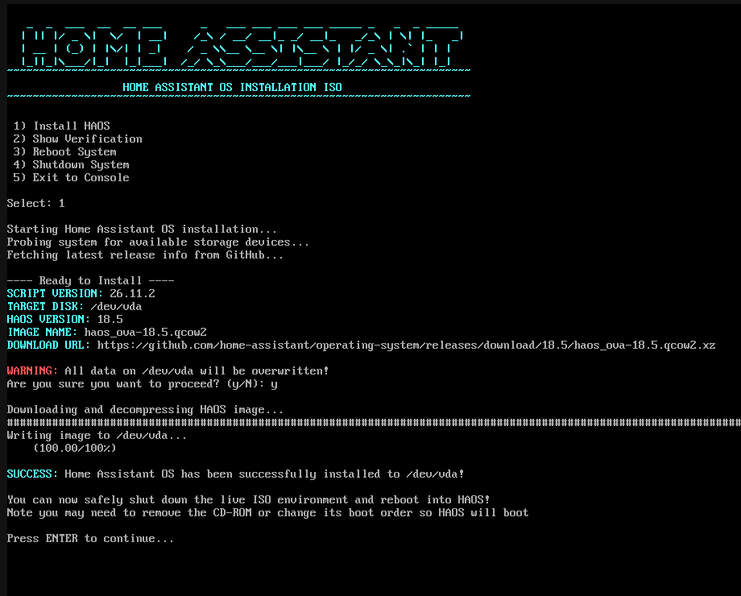

# truenas-haos-installer

An Installation ISO for Home Assistant OS.

This is a custom Arch Linux ISO designed to serve as installation media for installing Home Assistant OS (HAOS) inside a virtual machine on TrueNAS. When you boot this ISO, it automatically launches to an interactive menu so you don't have to type any commands. While this ISO (and installation script) could possibly work with other systems, at this time, it is intended for use on TrueNAS.

So, why choose Arch Linux for this project? Well, Arch has been my daily driver for many years, and for now, I'd consider this installation ISO a *proof-of-concept*. I didn't want to spend a bunch of time on something that may very well be useless. Since I'm already using Arch, building the custom ISO was simple.

### Setting Up the Build Environment
To prepare an Arch system and build the ISO, run these commands from your terminal:

```bash
# 1. Install the archiso tool package
sudo pacman -S archiso

# 2. Copy the default releng profile files to your build directory
cp -r /usr/share/archiso/configs/releng/* .

# 3. Create a temporary working directory and compile the ISO
mkdir -p /tmp/archiso-work
mkarchiso -v -w /tmp/archiso-work -o ./iso .
```

### ISO Modifications
To create this ISO, I made these minimal modifications to the default Arch profile:

* **Add Installation Script:** Added the [`install-haos`](https://github.com/tprelog/truenas-haos-installer/blob/main/airootfs/usr/local/bin/install-haos) script to `airootfs/usr/local/bin/`
* **Add Script Dependencies:** Added `jq` and `qemu-img` to [`packages.x86_64`](https://github.com/tprelog/truenas-haos-installer/commit/e35682a95d63851dcd2c21a5e1267df66c201607)
* **Configure Default Profile:** Added hooks for `install-haos` and set ISO info in [`profiledef.sh`](https://github.com/tprelog/truenas-haos-installer/commit/dabbfbd2c060e0d16bf6827bf440833ac16c3fdd)


## install-haos

An Installation Script for Home Assistant OS.

This is the script which handles all the heavy lifting. When an installation is started, the script probes the VM to find its drive path, then queries the GitHub API to fetch the latest HAOS release data. At this time, the script is only intended to run in a TrueNAS VM and it expects a single drive to be present (it will trigger an error and exit if multiple drives are detected). For now, the script will always download and install the current release of HAOS. If there is any interest, the ability to choose which version to install may be added in the future.




## License
Apache License 2.0 - The full text is in the LICENSE file.
